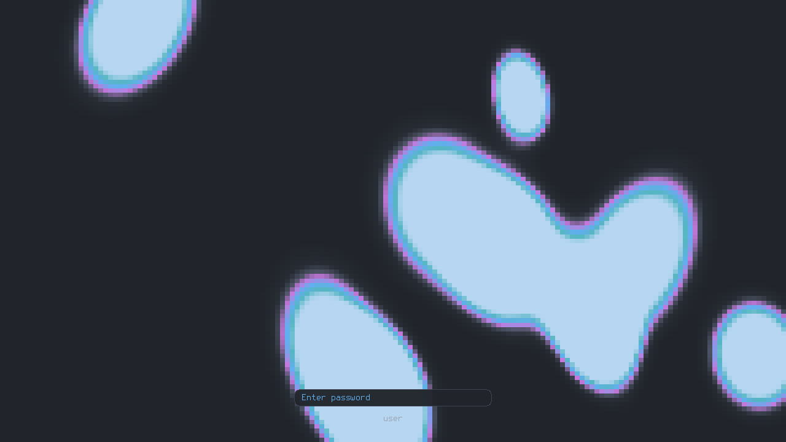
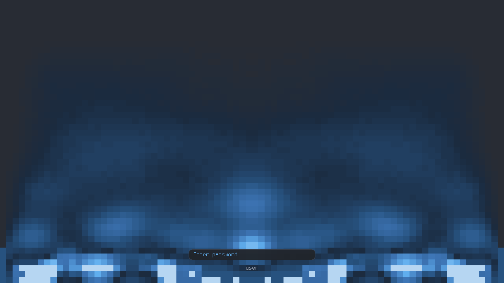

# lava-lock

An X11 screen locker with an animated lava-lamp or fire background, an Atom One
Dark password field, and PAM authentication. Built on SDL3; the animation is
rendered on the GPU and pauses while the monitors are powered off.



<details>
<summary>Fire animation (<code>--fire</code>)</summary>



</details>

## Install

Dependencies (Fedora names):

```sh
sudo dnf install gcc meson ninja-build SDL3-devel libX11-devel libXext-devel pam-devel
```

Build and install:

```sh
meson setup build
meson compile -C build
sudo meson install -C build
```

Then lock with `lava-lock` (or `lava-lock --fire`), or hook it up to
`xss-lock -- lava-lock --fork`. Try it without locking using
`lava-lock --preview --no-auth`, and see `lava-lock --help` for all options.

### xfce4-screensaver

`meson install` also adds two screensaver themes, **Lava Lamp (lava-lock)** and
**Fire (lava-lock)**. Pick one in *Screensaver Preferences*; xfce4-screensaver
keeps doing the locking and draws its own unlock dialog over the animation.

xfce4-screensaver only runs theme programs from its own directory, so this
installs a `lava-lock` symlink in `/usr/libexec/xfce4-screensaver` (change it
with `-Dxfce4_screensaver_dir=...`, or skip the themes with
`-Dxfce4_screensaver=false`). A user-prefix install (e.g. `--prefix ~/.local`)
cannot write there; it prints the one `sudo ln -sfn ...` command to run.

The embedded bitmap font is derived from Terminus Font, licensed under the SIL
Open Font License 1.1 (`third_party/terminus-OFL.txt`).
